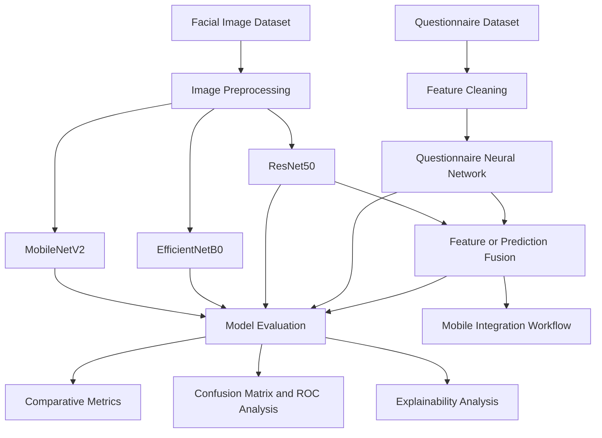

# Multimodal Autism Spectrum Disorder Detection Using Deep Learning

**A Research Prototype for Image-Based Learning, Clinical Questionnaire Analysis, Multimodal Fusion, and Explainable AI**

## Overview

This project presents a deep learning research prototype for Autism Spectrum Disorder (ASD) detection research using facial images and clinical or behavioral questionnaire features. It investigates how computer vision, structured-data learning, and multimodal fusion can be used to analyze complementary sources of information within an AI-based research framework.

The project brings together image classification, questionnaire-based prediction, comparative model evaluation, explainable AI, and mobile-oriented deployment into a unified research workflow.

The central research objective is to investigate whether combining visual representations with structured questionnaire features can provide useful predictive information beyond individual modalities.

## Research Objectives

- Develop deep learning models for facial-image-based ASD classification.
- Evaluate multiple convolutional neural network architectures under a consistent experimental framework.
- Investigate structured clinical and behavioral questionnaire features using neural networks.
- Design a multimodal late-fusion approach combining image and questionnaire representations.
- Compare image-only, questionnaire-only, and multimodal approaches using appropriate evaluation metrics.
- Analyze model behavior using explainability techniques, including Gradient-weighted Class Activation Mapping (Grad-CAM), where supported by the implemented models.
- Explore integration of trained models into a mobile-oriented application workflow.
- Document dataset preparation, preprocessing, model evaluation, and experimental reproducibility.

## System Architecture

The proposed research framework consists of two primary modalities.

### Modality 1: Facial Image Analysis

The computer vision branch processes facial images and learns discriminative visual representations using convolutional neural networks. The image-based experiments investigate the performance of different architectures for binary ASD-related image classification.

### Modality 2: Questionnaire-Based Analysis

The structured-data branch processes clinical or behavioral questionnaire features. The questionnaire model uses numerical input features to learn patterns associated with the target labels.

### Multimodal Late Fusion

The multimodal component investigates combining outputs or representations from the image and questionnaire branches. The objective is to compare the combined approach against its individual modalities and evaluate the contribution of each information source.

The final fusion implementation and its exact combination rule are documented alongside the corresponding experiment.

## Models and Experiments

| Model | Modality | Purpose |
|---|---|---|
| MobileNetV2 | Facial images | Lightweight image-classification baseline |
| EfficientNetB0 | Facial images | Efficient convolutional architecture |
| ResNet50 | Facial images | Deep residual-network baseline |
| Questionnaire Neural Network | Structured features | Independent questionnaire-based prediction |
| ResNet50 + Questionnaire Network | Multimodal | Late-fusion evaluation |

The experimental framework is designed to support comparison across modalities, model architectures, and fusion strategies.

## Evaluation Framework

The models are evaluated using relevant classification metrics, including:

- Accuracy
- Precision
- Recall (Sensitivity)
- F1-score
- ROC-AUC
- Confusion matrix

Additional analyses may include training and validation curves, threshold analysis, class-wise performance, and comparative visualizations.

Evaluation results should be interpreted in the context of dataset composition, split methodology, possible data leakage, class balance, and generalization limitations.

## Explainable AI

Model explainability is an important component of the research workflow.

Grad-CAM can be used to generate class-discriminative visual explanations for supported convolutional models. These heatmaps help inspect which image regions contribute to a model's predictions.

Explainability outputs are intended for model inspection and research analysis. They do not establish causal relationships or clinical validity.

## Technology Stack

- **Programming:** Python
- **Deep Learning:** TensorFlow and Keras
- **Computer Vision:** OpenCV and image-processing utilities
- **Data Processing:** NumPy and Pandas
- **Machine Learning:** Scikit-learn
- **Visualization:** Matplotlib and Seaborn
- **Development:** Jupyter Notebook, Google Colab, and Kaggle
- **Deployment exploration:** TensorFlow Lite and mobile application technologies

## Reproducibility

The project is organized around documented experiments, dataset preparation, model training, evaluation, and result reporting.

To reproduce an experiment:

1. Review the relevant notebook and its configuration.
2. Obtain the dataset from its original source and follow its access and usage terms.
3. Install the required dependencies.
4. Execute the preprocessing and evaluation steps for the selected experiment.
5. Save the resulting metrics, figures, and model artifacts.

Large datasets and trained model weights may be stored separately from the Git repository. Dataset access instructions and model artifact references should be provided where redistribution is not permitted.

## Research Contribution

This project focuses on the comparative investigation of unimodal and multimodal deep learning approaches for ASD-related classification.

Its principal research directions include:

- Comparative evaluation of multiple image-classification architectures.
- Independent analysis of structured questionnaire features.
- Investigation of late fusion across heterogeneous data modalities.
- Explainability-oriented inspection of image-based predictions.
- A documented workflow connecting model development, evaluation, and mobile-oriented integration.

The value of the framework lies in evaluating the individual modalities alongside their combined approach, rather than relying on a single model's accuracy as the sole measure of performance.

## Limitations and Responsible Use

This repository represents an academic research prototype. It is **not a clinically validated diagnostic system** and must not be used to diagnose ASD, assign clinical severity, or replace assessment by qualified professionals.

Facial-image datasets and questionnaire datasets may originate from different populations or collection procedures. Multimodal predictions should therefore not be interpreted as participant-level clinical fusion unless the relationship between the modalities has been established.

Performance estimates depend on dataset quality, sampling, class balance, split strategy, and external validity. Independent external validation and appropriate ethical review are necessary before any clinical application could be considered.

## Academic Context

**Final Year Project (FYP)**  

**Project Authors:** Shahbaz Ahmad and Waqas Ahmad

## Acknowledgments

We acknowledge the researchers, dataset creators, and open-source communities whose work supports research in deep learning, computer vision, structured-data learning, and explainable artificial intelligence.

## License

The repository license governs the original code and documentation contributed to this project. Individual datasets, third-party libraries, and pretrained models remain subject to their respective licenses and terms of use.

---

**Keywords:** Autism Spectrum Disorder, ASD Classification, Deep Learning, Multimodal Learning, Computer Vision, Clinical Questionnaire Analysis, Late Fusion, Explainable AI, Grad-CAM, Mobile AI.
